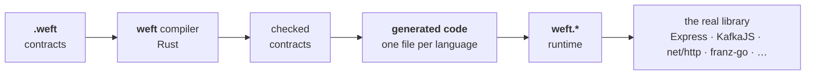

<div align="center">


# Weft

### One interface for every way services talk.

Write your contracts once. Call `weft.http`, `weft.gql`, `weft.grpc`, `weft.kafka`, `weft.ws` and the rest,<br>
in any language. Weft runs the real library underneath: Express, Apollo, KafkaJS, Spring Kafka, FastAPI, franz-go.

<br>

[](https://www.npmjs.com/org/weft-sdk)
[](https://pkg.go.dev/github.com/weft-sdk/weft/go)
[](https://github.com/weft-sdk/weft/actions/workflows/conformance.yml)
[](https://github.com/weft-sdk/weft/actions/workflows/compiler.yml)
[](https://github.com/weft-sdk/weft/blob/main/LICENSE)

[**Repository**](https://github.com/weft-sdk/weft) &nbsp;·&nbsp;
[**Quick start**](https://github.com/weft-sdk/weft#quick-start) &nbsp;·&nbsp;
[**Contracts**](https://github.com/weft-sdk/weft#contracts) &nbsp;·&nbsp;
[**Docs**](https://github.com/weft-sdk/weft/tree/main/docs) &nbsp;·&nbsp;
[**Roadmap**](https://github.com/weft-sdk/weft/blob/main/docs/12-roadmap.md) &nbsp;·&nbsp;
[**Discussions**](https://github.com/weft-sdk/weft/discussions)

</div>

<br>

---

## Why Weft

A modern system talks in many ways at once: REST, GraphQL, gRPC, Kafka, RabbitMQ, WebSockets. Each has its own library, its own types, its own errors, retries and tracing, and the types drift between the service that sends and the one that receives.

Weft is **one interface** over all of it. You describe what your services say in small, language-neutral contract files. A compiler turns them into typed code for your language. You call `weft.*`, and the library you already use runs underneath.

<br>

## Features

<table>
<tr>
<td width="33%" valign="top">

**One API**<br>
Thirteen transports, one way to call them, the same in every language.

</td>
<td width="33%" valign="top">

**Typed end to end**<br>
The sender and every receiver share the types generated from the contract.

</td>
<td width="33%" valign="top">

**Your stack stays**<br>
Express, KafkaJS, net/http and franz-go run underneath. `.raw` hands you the original.

</td>
</tr>
<tr>
<td valign="top">

**Behaviour that matches**<br>
Validation, retries, dead letters, deadlines and errors work the same everywhere.

</td>
<td valign="top">

**Observable by default**<br>
OpenTelemetry traces and metrics on every call, joined across services.

</td>
<td valign="top">

**Breaking changes caught**<br>
`weft check` tells you what a change breaks, and the version bump it needs.

</td>
</tr>
</table>

<br>

## How it works



```weft
package orders @version("1.0.0")

type Order { id: uuid  items: OrderItem[]  total: Money }

event order.placed: Order { key: id }

http /v1 {
  POST "/orders"       createOrder(body: CreateOrder) -> Order | OutOfStock
  GET  "/orders/{id}"  getOrder(id: uuid) -> Order?
}
```

```ts
import { weft } from "./weft.gen"

weft.http.post("/orders", ({ body }) => placeOrder(body))      // body is a typed CreateOrder
weft.kafka.on("order.placed", (order) => notifyCustomer(order)) // order is a typed Order
await weft.kafka.publish("order.placed", order)                 // a wrong payload does not compile
await weft.start()
```

<br>

## Get started

```sh
cargo install --git https://github.com/weft-sdk/weft weft-cli --locked   # the weft CLI
weft init                                                                # in your project
```

`weft init` detects TypeScript or Go, asks which transports you use, installs the packages, writes `weft.yaml` and a first contract, and generates the code.

<br>

## Transports and languages

| | Transport | TypeScript | Go |
| --- | --- | --- | --- |
| ● | `weft.http` | Express | net/http |
| ● | `weft.kafka` | KafkaJS | franz-go |
| ○ | `weft.gql` · `weft.grpc` · `weft.rpc` · `weft.ws` · `weft.sse` | Apollo · grpc-js · tRPC · Socket.io | gqlgen · grpc-go |
| ○ | `weft.mq` · `weft.nats` · `weft.redis` · `weft.cloud` · `weft.mqtt` · `weft.pulsar` | amqplib · nats · ioredis · cloud SDKs | amqp091-go · nats.go · go-redis |

&nbsp;&nbsp;● available now &nbsp;&nbsp; ○ on the [roadmap](https://github.com/weft-sdk/weft/blob/main/docs/12-roadmap.md)

The same contracts also target **Python, JVM, .NET, Rust, Ruby, PHP, Elixir, Swift and Dart**. Each language is a package that passes the same [conformance suite](https://github.com/weft-sdk/weft/tree/main/conformance), and the full matrix of libraries is in the [language docs](https://github.com/weft-sdk/weft/blob/main/docs/05-languages.md).

<br>

## Packages

| Where | Package |
| --- | --- |
| npm | [`@weft-sdk/core`](https://www.npmjs.com/package/@weft-sdk/core) · [`@weft-sdk/http-express`](https://www.npmjs.com/package/@weft-sdk/http-express) · [`@weft-sdk/kafka-kafkajs`](https://www.npmjs.com/package/@weft-sdk/kafka-kafkajs) |
| Go | `go get github.com/weft-sdk/weft/go` |
| CLI | `cargo install --git https://github.com/weft-sdk/weft weft-cli` |

<br>

## Repositories

| Repository | What is in it |
| --- | --- |
| [**weft**](https://github.com/weft-sdk/weft) | The compiler and CLI, the TypeScript and Go packages, the conformance suite, the website and the docs |

<br>

## Community

Ask a question in [Discussions](https://github.com/weft-sdk/weft/discussions), report a bug in [Issues](https://github.com/weft-sdk/weft/issues), or read [CONTRIBUTING](https://github.com/weft-sdk/weft/blob/main/CONTRIBUTING.md) to send a change. Security problems go through [private reporting](https://github.com/weft-sdk/weft/security/advisories/new).

<br>

<div align="center"><sub>Apache-2.0 &nbsp;·&nbsp; Contracts in, typed code out.</sub></div>
